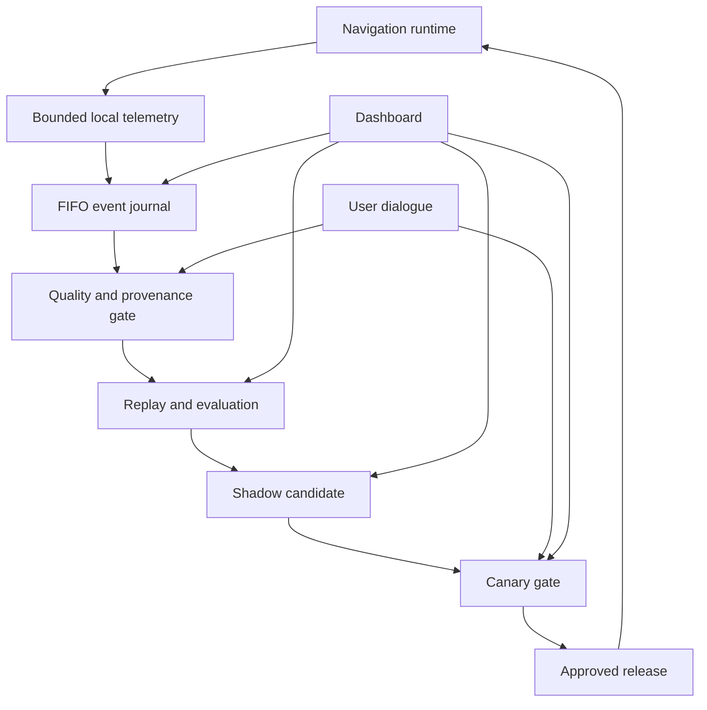

# AI Training Platform — Execution Master Plan

This document turns the master roadmap into an executable delivery plan for the routing platform. The navigation engine remains deterministic and available at every stage. Learning may observe, evaluate and propose changes, but it must never silently degrade routing.

## 1. Target operating model

The loop is deliberately one-directional at the safety boundary: observation can flow into learning, but no candidate can alter production routing without evaluation, approval and rollback protection.

## 2. Delivery principles

1. **Deterministic fallback:** Valhalla/local routing remains usable when cloud, model, storage or network services fail.
2. **No silent regressions:** every known failure becomes a replay fixture and a release gate.
3. **Bounded resources:** storage, queue length, upload size, CPU, memory and retry work have hard limits with headroom.
4. **Evidence first:** a learned rule needs provenance, quality, confidence and a reproducible explanation.
5. **Reversible changes:** releases are versioned, canaried and automatically rolled back.
6. **Human-directed dialogue:** ambiguous requests produce questions; commands are structured, idempotent and audited.
7. **Privacy by design:** raw location data is minimized, redacted and deleted according to policy.

## 3. Milestones and exit criteria

| ID | Milestone | Main deliverables | Exit gate |
|---|---|---|---|
| M0 | Foundation | module boundaries, contracts, versioning, CI checks, ADRs | routing builds without intelligence |
| M1 | Evidence pipeline | route/GPS/maneuver/voice/feedback events, provenance, deduplication, quarantine, local journal | every event is versioned, timestamped and quality-scored |
| M2 | Knowledge base | immutable evidence, facts, patterns, contradictions, confidence, traceability | uncertain data cannot change production |
| M3 | Dialogue/control | text and voice dialogue, questions, investigate/simulate/explain/approve/reject/rollback commands | ambiguous commands are blocked or clarified |
| M4 | Replay/evaluation | frozen fixtures, deterministic checks, left/right and timing regressions, GPS jitter/fallback tests | candidate passes worst-case gates, not only averages |
| M5 | Shadow learning | candidate generation, shadow comparison, cost and confidence reporting | zero production side effects |
| M6 | Canary/rollback | bounded rollout, health checks, release manifests, automatic rollback | degraded candidates are removed automatically |
| M7 | Operations console | charts, confidence bands, pipeline/storage health, experiments, knowledge explorer, work log, chat and approvals | operator can explain current state without raw logs |
| M8 | Resource optimization | active learning, cache, compaction, adaptive polling, quota alarms, degraded modes | provider limits are never exceeded |
| M9 | Production integration | mobile adapter, compatibility negotiation, signed artifacts, stale-data handling | unavailable training service cannot break navigation |
| M10 | Continuous improvement | scheduled evaluation, drift monitoring, issue creation, release reports | learning stops when expected gain is below cost |

## 4. Concrete implementation sequence

### Phase A — Contracts and safety baseline (M0/M1)

- Keep `performance-v1` as the first telemetry schema.
- Add a shared event envelope with schema version, event ID, session/route IDs, capture time, source, quality and payload hash.
- Add explicit runtime modes: `OFFLINE`, `OBSERVE`, `SHADOW`, `CANARY`, `PRODUCTION`.
- Add contract compatibility checks to CI.
- Connect Android telemetry to a bounded local journal; enqueue must be non-blocking.
- Add FIFO eviction before a write can exceed the configured high-water mark.
- Never upload raw events directly from the navigation thread.

**Acceptance:** route start, route progress, maneuver, voice and fallback samples survive temporary network loss without affecting navigation.

### Phase B — Evidence quality and learning safety (M2/M4)

- Normalize units and timestamps.
- Deduplicate by event ID and payload hash.
- Quarantine malformed, contradictory or low-quality samples.
- Build replay fixtures from the observed defects: left/right, delayed voice, GPS jitter, fallback despite tiles and WLAN loss.
- Calculate both average and worst-case metrics.
- Require minimum sample counts and confidence thresholds.
- Store the exact evidence IDs behind every derived rule.

**Acceptance:** a candidate cannot pass while any protected regression gate is red.

### Phase C — Shadow, canary and rollback (M5/M6)

- Generate candidate rules/models only from accepted evidence.
- Run candidate and active version side-by-side.
- Compare route quality, maneuver correctness, voice timing, fallback rate, latency, CPU, memory and battery cost.
- Promote only after a bounded canary window.
- Roll back on any critical gate violation, stale artifact, missing provenance or resource breach.
- Keep the last known-good artifact available locally.

**Acceptance:** every production change has a release manifest, artifact hash, gate results and rollback target.

### Phase D — Dialogue and visual operations (M3/M7)

- Add a chat/voice control endpoint that exposes current work, metrics, evidence and open questions.
- Convert free-form instructions into typed intents.
- Ask a clarification question whenever scope, route, time range or desired action is ambiguous.
- Require confirmation for approval, promotion, deletion and rollback.
- Render learning progress, performance trend, regression status, storage headroom, source health and active work in one console.
- Display confidence intervals, sample counts, data age and source attribution beside every chart.

**Acceptance:** the user can ask what the AI is doing, why it reached a conclusion, what changed and how to stop or revert it.

### Phase E — Optimization and continuous operation (M8/M10)

- Prioritize samples with high expected information gain.
- Compact old events into aggregates before FIFO eviction where policy permits.
- Use exponential backoff with jitter for failed uploads.
- Reserve provider headroom and enforce local hard limits.
- Schedule evaluation during idle windows.
- Stop or slow learning when expected quality gain is below compute/storage cost.
- Create a regression issue automatically when a gate fails.

**Acceptance:** the loop improves measurable quality over time without unbounded cost or storage.

## 5. Non-negotiable release gates

A candidate is rejected if any protected gate fails:

- maneuver side accuracy below baseline;
- voice cue timing regression above the configured tolerance;
- fallback rate increases without an approved explanation;
- route completion or reroute latency regresses;
- GPS jitter correction worsens protected fixtures;
- CPU, memory, battery or storage budget is exceeded;
- evidence count, provenance, schema compatibility or artifact hash is missing;
- rollback rehearsal fails.

Averages are never sufficient. The gate set evaluates median, p95/p99, worst-case fixture results and confidence intervals.

## 6. Data and storage limits

The storage controller uses two watermarks:

- **soft limit:** start compaction and upload prioritization;
- **hard limit:** reject new oversized batches, evict oldest eligible records and retry the write.

The hard limit is never exceeded because admission is checked before persistence. Protected records (active release manifest, audit records and unsent failure metadata) are reserved separately. FIFO deletion applies only to eligible telemetry/evidence records and is observable in the dashboard.

## 7. Recovery and fallback matrix

| Failure | Runtime behavior | Learning behavior |
|---|---|---|
| no network | local navigation continues | queue locally, retry with backoff |
| cloud unavailable | no user-visible routing interruption | remain in observe/offline mode |
| malformed event | ignore for routing | quarantine and count |
| model timeout | use deterministic rule/Valhalla result | record timeout and continue |
| storage near hard limit | preserve protected records | compact then FIFO-evict oldest eligible data |
| candidate gate failure | keep active version | create regression item and block promotion |
| corrupt artifact | keep last known-good artifact | quarantine artifact and alert |

## 8. Definition of done for the whole program

The program is complete only when:

- navigation works with the intelligence service completely disabled;
- every learned change is reproducible from versioned evidence;
- regression fixtures cover all known navigation defects;
- storage and upload limits are enforced before writes;
- the dashboard shows current work, quality, data age, confidence and rollback state;
- dialogue commands are auditable and require confirmation where appropriate;
- canary and rollback have been exercised successfully;
- scheduled learning produces measurable improvement or explicitly pauses due to insufficient gain.

## 9. Current repository status

Completed:

- storage/retention policy and FIFO ledger documentation;
- performance metric contracts;
- release-gate and learning-loop documentation;
- local PostgreSQL/MinIO development stack;
- Android runtime performance telemetry (merged in PR #34).

Next implementation slice:

1. connect telemetry samples to the versioned event envelope;
2. add bounded local FIFO journal and tests;
3. add replay fixtures for the known navigation defects;
4. expose queue/storage/quality state to the dashboard;
5. add shadow evaluation before any routing-affecting change.

This plan is intentionally executable in small, reviewable pull requests. Each slice must pass CI before the next slice is started.
